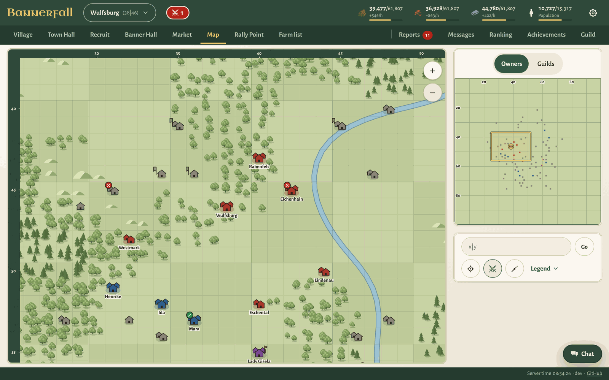
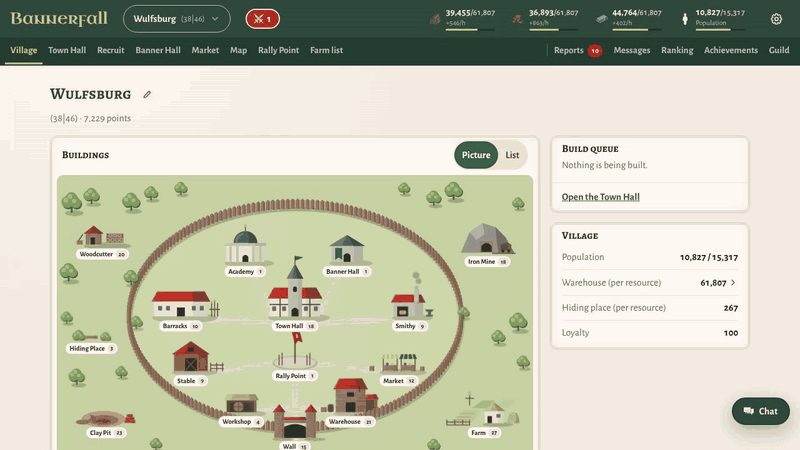
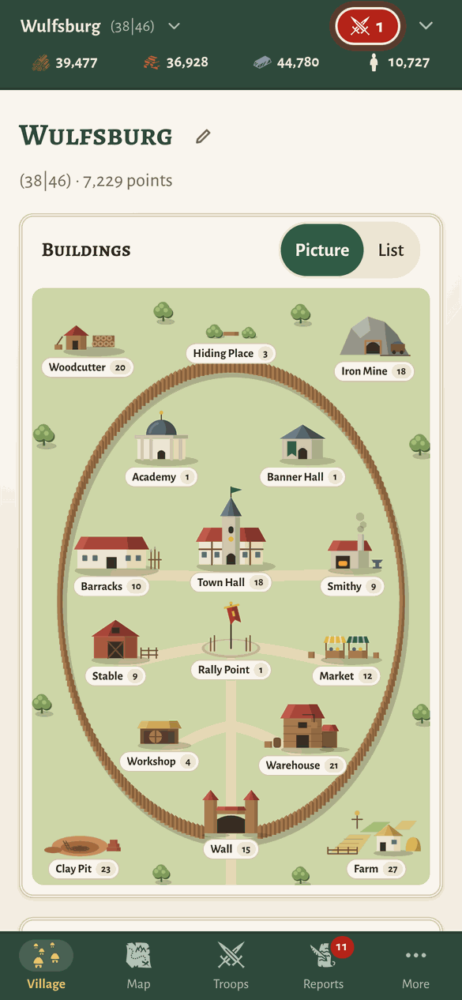
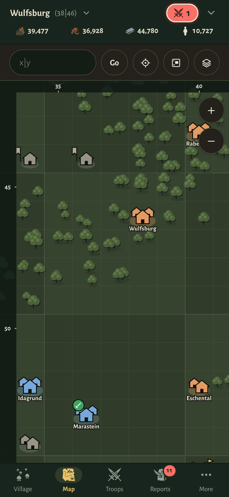
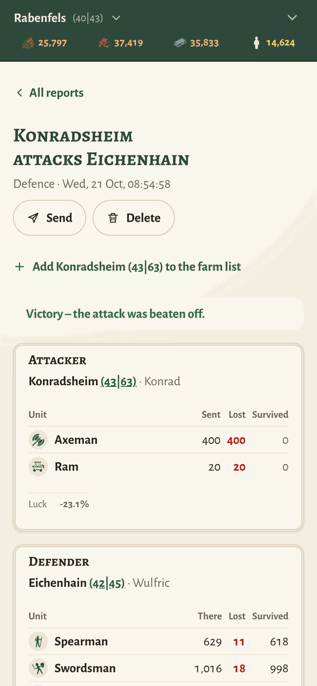

<h1 align="center">
  <picture>
    <source media="(prefers-color-scheme: dark)" srcset="docs/images/readme-header-dark.png">
    
  </picture>
</h1>

<p align="center"><b>A browser strategy game for a group of friends: build villages, raise armies, take your neighbours' villages and hold the map.</b><br>
Free software you host yourself, in English and German, made for phones first.</p>

<picture>
  <source media="(prefers-color-scheme: dark)" srcset="docs/images/readme-map-dark.png">
  
</picture>

Bannerfall is a strategy game in the style of the classic "villages, troops, attacks" browser games, built for a small group of friends on a server of their own. Everyone starts with one village, builds it up, trains troops, raids barbarians and attacks or supports the others; nobles take villages over, and a world ends when one side holds the map, holds the banner keeps or leads on an end date the host sets. Computer-controlled NPC lords and barbarian villages fill the world when only a few people play, so two friends against twenty lords is a full round too.

Version 1.6 makes Bannerfall feature complete: what was planned for the game is in, and later releases fix and polish.

## A round in twenty seconds



<sub>Recorded in a development world, where travel times can be skipped; sped up 1.5 times.</sub>

<p align="center">
  
  &nbsp;
  
  &nbsp;
  
</p>

## What is in the game

**Villages**
- Sixteen buildings, shown as a drawn village or as a list, with a build queue; buildings can be demolished again, one level at a time.
- Wood, clay and iron, a warehouse, a hiding place and a farm that limits the population.
- A market for sending resources to your own and other villages, trade offers between players, and an exchange with the market itself.
- Village automation from the third village on: build plans that work through their buildings and levels by themselves, also while you are offline, and refill a recruit template.
- A private note on any village.

**Troops and battle**
- Thirteen units: infantry, cavalry, scouts, rams, catapults, nobles, the paladin and the banner thief; archers and mounted archers are optional.
- Attacks, supports and scouting, attack trains (several attacks that land together, in order), walls, rams, catapults, loot and luck. Morale weakens attacks on much smaller players; a night bonus is optional.
- Conquest with nobles, who lower a village's loyalty; every village and noble beyond the first few makes the next noble dearer.
- Unit levels researched in the Smithy (optional), the paladin and the banner thief trained in the Banner Hall.
- Banners found in battle, flown from the Banner Hall, fused and stolen, and standards that only paladins carry.
- Battle and scout reports, an attack simulator, a farm list with troop templates and "send all", and recruit templates.

**The world**
- A drawn map with terrain, movement lines and markers, owner and guild colours, an overview map and farming straight from the map.
- Barbarian villages that grow and can build walls. NPC lords with their own personalities play the same game: they build, farm, attack, conquer, join lord guilds, ship their surplus and can learn from the players' attacks.
- Four map spreads (Close, Normal, Wide, Vast), and friends in one guild start next to each other.
- Victory by domination (holding most of the villages), by holding the banner keeps around the centre, or by the most points on an end date. An ended world freezes and stays readable.

**Together**
- Guilds with their own chat, a world chat, private messages and blocking.
- A ranking by points, attacks, defence and loot, statistics with daily charts, and achievements.
- Push notifications on the phone or computer while the game is closed: incoming attacks, a lost village, messages, returning troops, a full warehouse.
- Built for phones and touch first, then widened for the desktop; light and dark mode, five colour themes, medieval or classic icons; English and German.

**For the host**
- One Docker image with PostgreSQL behind Caddy, which fetches the HTTPS certificate by itself.
- A guided setup for a new world: a starting point (*Friends' round*, *Long-running world*, *Together against the lords* or *Custom*), then the pace, map, opponents, rules, victory and opening time.
- An admin page and the `bannerfall-admin` command line: players, bans, world settings, events, NPC lords, an audit log and a log of suspicious requests.
- Daily backups, a restore script and updates in one command; several worlds on one server; optional login through an OpenID Connect account server, with one account for several worlds.

The rules and all numbers are in `docs/plan/02-game-rules.md`. To run a world of your own, follow `docs/hosting.md`.

Not affiliated with any existing game. Own name, own numbers, own village picture and map; the medieval icons are credited below.

## Repository layout

| Folder | What |
|---|---|
| `server/` | Spring Boot app (Java 25, Gradle Kotlin DSL, PostgreSQL) |
| `web/` | React + TypeScript app (Vite, pnpm) |
| `docs/` | Game rules (`plan/02-game-rules.md`, banner art in `plan/banners/`), the hosting guide (`hosting.md`), the release notes (`releases/`) and the README images and clip (`images/`) |
| `compose.yaml` | Local development database (PostgreSQL 18) |
| `Dockerfile`, `compose.prod.yaml`, `Caddyfile`, `.env.example` | Production: the image, app + database + Caddy, settings template |
| `edge/` | The shared Caddy for several worlds on one server (`docs/hosting.md`, section 12) |
| `ops/` | `bannerfall-admin` (host console), `bannerfall-backup`, `bannerfall-restore`, `bannerfall-update` |
| `.run/` | Shared IntelliJ run configurations |

## Prerequisites

- JDK 25 (Eclipse Temurin), with `JAVA_HOME` pointing to it
- Docker Desktop (running; also needed for the Testcontainers tests)
- Node 24 LTS and pnpm

## Run locally

1. Start the backend (starts the database from `compose.yaml` automatically):

   ```
   cd server
   ./gradlew bootRun
   ```

   The API runs on <http://localhost:8080>, Swagger UI at <http://localhost:8080/swagger-ui.html>.
   To start the database yourself instead: `docker compose up -d` in the repo root.

2. Start the frontend:

   ```
   cd web
   pnpm install
   pnpm dev
   ```

   Open <http://localhost:5173>. Vite forwards `/api` and `/ws` to the backend.

3. To test on a phone in the same network: `pnpm dev --host`, then open the PC's LAN IP on port 5173.

## First admin

The `/admin` page and `/api/admin/**` need an account with the role `ADMIN`. There is no admin at the start: register normally in the app (the player and the starting village are created with it), then promote that account in the database and log in again (from then on a role change by the host works at once):

```
docker compose exec db psql -U bannerfall -c "update account set role = 'ADMIN' where username = 'YourName'"
```

(`compose.yaml`'s database service; with another database use your own `psql`. On a production server the host console does it: `docker compose -f compose.prod.yaml exec app bannerfall-admin player YourName role admin --yes`.) Never insert accounts by hand: every account needs its player and village, or `/api/me` fails. From then on the invite code, the world settings and failed events are on the `/admin` page.

## Operating the server

The host runs the container and has two doors, both calling `/api/admin/**`: the `/admin` page (log in as an ADMIN account, tabs Status, Players, World, Events, NPC lords, Suspicious, Cheats, Audit) and the command line `bannerfall-admin`.

**Token.** The CLI needs `BANNERFALL_ADMIN_TOKEN` (at least 32 characters, random; the server refuses to start with a shorter one; empty = no CLI). Make one with `openssl rand -hex 24` and put it in the server's environment. Five wrong tokens in a minute from one address block token requests from that address for a minute (429); the CLI on `localhost` inside the container isn't affected by guessing from outside.

**CLI.** In the container: `docker compose exec app bannerfall-admin` (menu) or with a command; locally `ops/bannerfall-admin` with `BANNERFALL_JAR=server/build/libs/bannerfall.jar` and the same token in the environment (`BANNERFALL_URL` if the server isn't on `http://localhost:8080`).

```
bannerfall-admin status
bannerfall-admin players
bannerfall-admin player Anna reset-password          # prints a new password once
bannerfall-admin player Anna reset-password --password   # asks for one (not shown, not in the history)
bannerfall-admin player Anna role admin --yes
bannerfall-admin player Anna revoke-achievement FIRST_BLOOD --reason "…"   # for good, he can't earn it again
bannerfall-admin world                  # all world settings
bannerfall-admin world set invite-code newcode
bannerfall-admin world set victory-mode KEEPS   # DOMINATION (default), KEEPS or NONE; see 02-game-rules §22
bannerfall-admin world end --at "2026-11-07 20:00"   # end date (Berlin time); --now, --clear; world reopen takes an end back
bannerfall-admin events failed          # and: events retry <id>
bannerfall-admin npc list               # npc spawn <personality>, npc difficulty NORMAL
bannerfall-admin barbarians spawn 40 52
bannerfall-admin banner list Anna       # banner grant Anna WAR 1 --reason "…", banner revoke <id>
bannerfall-admin broadcast "Restart in 5 minutes"
bannerfall-admin audit --limit 20
bannerfall-admin suspicious             # who sent requests the game never sends (last 30 days)
bannerfall-admin player Anna ban --reason "cheating" --days 7   # or --until <instant>; without either: permanent
bannerfall-admin player Anna unban
bannerfall-admin check                  # impossible states in the database (read only)
bannerfall-admin logs --lines 50
bannerfall-admin status --json          # --json on every command
```

Exit codes: 0 ok, 1 the server refused (or can't be reached), 2 wrong usage. Destructive commands ask for the name (or take `--yes`; without a terminal they need it).

**Cheats.** Off by default. `BANNERFALL_CHEATS_ENABLED=true` turns on `bannerfall-admin cheats …` and the Cheats tab (resources, units, finish orders and movements on any village); without it these answer 404. Status and the CLI show "CHEATS ON" while it is set. Every host action is in the audit log (`audit`, Audit tab).

**Abuse protection.** Everyone logged in can send requests by hand, so the server checks every rule itself. Writes are limited per account (10 per second, bursts of 30; `bannerfall.abuse.write-limit.*` in `application.yml`; beyond it `429`). Requests the web client never sends (another player's ids, impossible numbers, wrong CSRF token) are recorded in the suspicion log (`suspicious`, Suspicious tab, kept 30 days); 20 of them within 10 minutes lock the account for an hour (`bannerfall.abuse.auto-lock.*`, audited as `AUTO_LOCK`, shown in `status`; admins are exempt). A ban (`ban` / `unban`, Players tab) refuses the login with the reason and the date and ends the account's open sessions and WebSockets at once; its villages stay. `check` (and a nightly job, WARN lines in `server.log`) looks for impossible rows such as negative resources or movements without an event.

**Forgotten password.** `bannerfall-admin player <name> reset-password` (or Players tab) and tell the player; they can change it under Menu > Change password.

## Deploying

Bannerfall runs as three containers from `compose.prod.yaml`: `app` (Spring Boot with the web app inside), `db` (PostgreSQL 18, not reachable from outside) and `caddy` (HTTPS and reverse proxy, only with the profile `caddy`).

A complete step-by-step guide for a fresh Linux server (DNS, SSH key login, firewall, Docker, first start, backup drill, updates) is `docs/hosting.md`.

**Once, on the server** (a vServer with Docker and the compose plugin, 2 vCPU / 4 GB RAM is comfortable; the DNS A/AAAA records of the domain point to it and ports 80 and 443 are open):

```
git clone https://github.com/Remph/bannerfall.git /opt/bannerfall    # or copy compose.prod.yaml, Caddyfile, .env.example and ops/
cd /opt/bannerfall
cp .env.example .env     # then edit: POSTGRES_PASSWORD, BANNERFALL_ADMIN_TOKEN (both start empty and must be filled), BANNERFALL_DOMAIN, BANNERFALL_IMAGE
chmod 600 .env
```

`openssl rand -hex 24` makes a good password and a good token (the token needs at least 32 characters). Keep `.env` private; it is not in git. The host cheats stay off (`BANNERFALL_CHEATS_ENABLED` is not passed to the container).

**Build and ship** (on your PC, in the repo root; replace `1.6.0` by the version):

```
docker build -t ghcr.io/your-name/bannerfall:1.6.0 --build-arg VERSION=1.6.0 .
docker login ghcr.io          # once, with a GitHub token that may write packages
docker push ghcr.io/your-name/bannerfall:1.6.0
```

(The Dockerfile builds the web app, the server jar and a small runtime image; the build takes a few minutes the first time. `VERSION` is shown by `bannerfall-admin status`. Without a registry: `docker save ghcr.io/your-name/bannerfall:1.6.0 | ssh server docker load`, or build on the server itself: `docker build -t bannerfall:1.6.0 --build-arg VERSION=1.6.0 .` in the cloned repo and `BANNERFALL_IMAGE=bannerfall:1.6.0` in `.env` (needs about 4 GB of memory including swap). A private package needs `docker login ghcr.io` on the server too.)

**Start or update** (on the server): set `BANNERFALL_IMAGE=ghcr.io/your-name/bannerfall:1.6.0` in `.env`, then

```
docker compose -f compose.prod.yaml pull        # skip this when the image was loaded or built on the server itself
docker compose -f compose.prod.yaml up -d
docker compose -f compose.prod.yaml ps          # app and db "healthy"
```

The database migrates itself at start (Flyway). Everybody is logged out by an update (sessions are in memory); announce it with `bannerfall-admin broadcast "Update in 5 minutes"`. Caddy asks Let's Encrypt for the certificate as soon as it starts, so the DNS record must already point to the server (check with `nslookup`; repeated failures run into Let's Encrypt's rate limit). `docker compose -f compose.prod.yaml logs caddy` shows `certificate obtained successfully`; <https://your-domain> should answer within a minute. Use the world's own name as `BANNERFALL_DOMAIN` (for example `play.example.com`), not the main domain of a landing page you may run beside it.

**Updating in one command** (since 1.4.1, in a git checkout on the server): `ops/bannerfall-update 1.4.1` does the steps of an update in order and stops at the first one that fails. It checks that the checkout has no local changes, fetches the tags, pulls the image for exactly that version (the image `BANNERFALL_IMAGE` names now, with the new tag; `--repo` names another, `--build` builds `bannerfall:<version>` on the server instead), checks the tag out, checks that its `compose.prod.yaml` works with your `.env`, takes a backup with `ops/bannerfall-backup`, warns the players in the chat, waits a minute (`--wait <seconds>`, `0` for no warning), sets `BANNERFALL_IMAGE` in `.env`, restarts the app, waits until it is healthy and reports the new version, and runs `bannerfall-admin check`. It shows the plan and asks once first (`--yes` skips the question). Nothing changes for the players before the backup is done, and stopping it before the restart (Ctrl+C, or a dropped connection) puts the old checkout back. If the new version doesn't come up and ran no database migration, the script puts the old image and checkout back by itself. If it already migrated the database, it stops and prints how to restore the backup it took. Read the release notes first, since some releases add settings or need a step of their own. `ops/bannerfall-update --help` lists the options.

**Feature switches.** Some of the bigger features can be switched per world. A new world starts with banners, the paladin, morale and the rising noble price on, and with barbarian walls, unit levels, archers and learning NPC lords off. The guided setup asks for the important ones. What each release switches in a running world is in its release notes (`docs/releases/`, *Heads-up for running worlds*).

| Feature | Setting (`bannerfall-admin world set …`, or the admin page, tab World) | Default |
|---|---|---|
| Barbarian walls (02 §11) | `barbarian-walls-enabled true`; also `barbarian-wall-start-days`, `barbarian-wall-max-level`, `barbarian-walls-rebuild` | off |
| Unit levels in the Smithy (02 §5.4) | `unit-levels-enabled true` | off |
| Paladin (02 §5.5; his numbers are placeholders until there is more play data) | `paladin-max-slots 0` turns him off; `paladin-villages-per-slot` | on (4 villages per slot, at most 5) |
| Banners (02 §21) | `banners-enabled false` turns them off (existing banners are kept, asleep); `banner-drop-factor` (0–3, 0 = no drops) | on |
| Archers (02 §5.6) | `archers-enabled true` | off |
| Morale (02 §8.2) | `morale-enabled false` turns it off; `morale-floor` (30–100) | on (floor 30 %) |
| Rising noble price (02 §5.7) | `noble-price-step` (0–1, 0 = the same price for every noble) | 0.25 |
| Village automation (02 §25) | `automation-villages` (from a player's N-th village; 0 = none) | from the 3rd village |
| NPC lords learning from players (02 §11b) | `npc-learning-enabled true` | off |
| Friends start next to their guild (02 §2) | `guild-start-together false` turns it off | on |

**First steps in a new world** (order matters: do 1 and 2 before telling anybody the address). A fresh production world starts in the **pre-game** (M14g): friends can register and chat, nobody has a village yet, and the map is created at the **opening time** you set in the setup (or on the admin page, tab World). Until then you can still change everything, including the map spread (how far apart players start: Close, Normal, Wide or Vast), map size, barbarians and NPC lords.

1. Register yourself in the browser, then ask for a one-time setup link: `docker compose -f compose.prod.yaml exec app bannerfall-admin setup`. It prints `https://<your domain>/setup?code=…` (the domain comes from `BANNERFALL_DOMAIN` in `.env`), valid for 30 minutes and only once.
2. Open the link while logged in: it makes your account the admin and starts the **guided setup**, a wizard with a starting point (*Friends' round*, *Long-running world*, *Together against the lords* or *Custom*) and one step each for the basics (name, invite code, guilds), the pace, the map and opponents, the rules, the victory and the opening time. Every step is saved when you go on; you can skip it and use the admin page instead. Without the wizard: `... bannerfall-admin world set invite-code <secret>` (the default is `change-me`), `... bannerfall-admin player YourName role admin --yes` and the admin page.
3. Tell your friends the address and the invite code. They can register right away.
4. Change the opening time if you like (setup, admin page, or `... bannerfall-admin world open --at "2026-10-17 18:00"`; `--clear` takes the time back, `--now` opens at once). At that moment every registered player gets a village and the game starts. The login page shows the opening time and a countdown.

How the world is won is set on the admin page (tab World, cards *Victory* and *End of the world*) or with `world set victory-mode`: by default a side (a guild, or a player without one) wins once it holds 60 % of all villages for 48 hours; `KEEPS` places banner keeps around the map centre instead, and `NONE` leaves the end to you. An end date (`world end --at …`) works in every mode: the most points win then. An ended world is frozen and stays readable; `world reopen` takes the end back. The rules are in `docs/plan/02-game-rules.md` §22.

Everything else about running the world is under *Operating the server* above. A short daily look keeps a world healthy: `bannerfall-admin status`, `events failed`, `check`, `suspicious` and `logs --lines 50`.

**Logs.** The app writes `server.log` and `server.err` into the volume `logs` (rolled daily and at 10 MB, 14 days): `docker compose -f compose.prod.yaml exec app tail -n 100 /app/logs/server.err`, or `bannerfall-admin logs`. The console output is in `docker compose -f compose.prod.yaml logs app`. Docker keeps at most three files of 10 MB of console output per container (`compose.prod.yaml`, `x-logging`), and a new container (every update) starts empty. Caddy keeps no access log, and its own log leaves the visitors' addresses out (`Caddyfile`); the privacy page (`/privacy`) tells players so.

**TrueNAS or another proxy instead of Caddy.** Leave `COMPOSE_PROFILES` empty in `.env` (no Caddy) and let your proxy forward the domain to the app's port (`APP_PORT`, default 8461; set `APP_BIND=0.0.0.0` in `.env` if the proxy is another machine or container, and keep the port closed to the internet). In nginx proxy manager turn on *Websockets Support*, set the scheme to `http`. The game keeps a WebSocket open; server and page send STOMP heartbeats every 10 seconds, so the proxy's default read timeout of 60 seconds never fires on a healthy connection (nothing to add under *Advanced*). The proxy must pass `X-Forwarded-For` and `X-Forwarded-Proto` (nginx proxy manager does) and keep the `Host` header: the app trusts them for the client address, the secure cookie and the WebSocket origin check. Hide `/actuator` from the internet in the proxy (it only holds the health check). The privacy page (`/privacy`) tells players that no access log is kept: switch your proxy's access log off, or tell your players about it yourself.

**Several worlds on one server.** Each world runs `compose.prod.yaml` in a folder of its own, with its own `COMPOSE_PROJECT_NAME` and `APP_PORT` in `.env` and no `caddy` profile; one shared Caddy from `edge/` holds ports 80 and 443 and passes each world's domain to that world's port. The step-by-step guide is `docs/hosting.md`, section 12.

**Ports.** Every port on the host is a setting in `.env` (see `.env.example`): `APP_PORT` (the app, default **8461**, only on `127.0.0.1` unless `APP_BIND` says otherwise), `HTTP_PORT` and `HTTPS_PORT` (Caddy, default 80 and 443). Change the Caddy ports only if a router forwards 80/443 to them: Let's Encrypt has to reach Caddy on 80/443 from the internet. Inside the containers nothing changes (the app listens on 8080, the database on 5432, neither reachable from outside). For development `compose.yaml` takes `DB_PORT` (default 5432) for the database on your PC, and the server reads the same variable.

### Backups

```
ops/bannerfall-backup       # writes backups/bannerfall-<date>-<time>.sql.gz, keeps 14 days (KEEP_DAYS), checks the dump
```

Run it daily with cron on the server (`crontab -e`; the path is where you cloned the repo; the script must be executable, it is in git). Create the folder first (`mkdir -p /opt/bannerfall/backups`): the shell opens the log file before the script runs, so a missing `backups/` stops the very first run:

```
17 3 * * * /opt/bannerfall/ops/bannerfall-backup >> /opt/bannerfall/backups/backup.log 2>&1
```

A backup on the same disk is no protection against losing the server: copy `backups/` somewhere else now and then (`scp`, `rsync`, a cloud drive). The volume `logs` and the Caddy certificates are not part of it (certificates are fetched again).

### Restoring a backup

```
ops/bannerfall-restore backups/bannerfall-2026-10-09-0317.sql.gz
```

It asks you to type `restore`, stops the app, dumps the current database to `backups/pre-restore/` (your way back if you picked the wrong file), **replaces the whole database** with the dump (everything after the backup is lost), and starts the app again. If loading fails, it says so and leaves the app stopped. `--yes` after the file name skips the question. After restoring, check `bannerfall-admin status` and `bannerfall-admin check`. Restoring was tested with a local copy of this setup (register a player, back up, register another, restore: the second one is gone).

A backup of the old server also moves the world to a new one: install the stack as above, copy the dump over, `ops/bannerfall-restore <dump>`.

## Tests and formatting

```
cd server
./gradlew check           # the tests (needs Docker running) and spotlessCheck
./gradlew test            # the tests only
./gradlew simulationTest  # the NPC lord simulation (~15 min, prints balance tables)
./gradlew spotlessApply   # format Java (google-java-format, AOSP style) and Gradle files
./gradlew spotlessCheck   # fails if something is not formatted (also part of ./gradlew check)

cd web
pnpm test
pnpm format               # Prettier
pnpm format:check
pnpm lint                 # ESLint
pnpm check:api            # the API types match src/api/openapi.json
pnpm build
```

There is no CI on pull requests in the development repository: run these before you open one.

After changing REST endpoints, update the web's copy of the API description and regenerate the typed
API client: `cd server && ./gradlew test --tests '*OpenApiSnapshotTest' -PupdateOpenApi`, then
`cd web && pnpm gen:api`. The checks fail while either is out of date (`OpenApiSnapshotTest`, `pnpm check:api`).

## Versions (recorded at M0, 2026-10-02)

- Java 25 (Temurin), Spring Boot 4.1.1, Gradle 9.8.1, PostgreSQL 18, springdoc-openapi 3.1.1, Spotless 8.10.4
- Node 24, pnpm, React 19, Vite 8, TypeScript 6 (exact versions: `web/package.json`)

## Releases and issues

Releases are published to <https://github.com/Remph/bannerfall>, one commit per release with its tag (`v1.2.1`, …). Bug reports and ideas are welcome as issues there. Pull requests are not accepted, because the next release would overwrite them; describe the change in an issue instead.

## License

Bannerfall is free software under the [GNU Affero General Public License](LICENSE), version 3 or (at your option) any later version (`AGPL-3.0-or-later`). If you run a modified version of the server for other players, the AGPL requires you to offer them its source code.

The name "Bannerfall" and the bannerfall.de domain are not covered by the license. Third-party dependencies and the bundled web fonts (OFL) keep their own licenses.

The medieval icons in `web/src/components/medievalIcons.ts` are from [game-icons.net](https://game-icons.net), by Lorc, Delapouite, Skoll, HeavenlyDog, Cathelineau and DarkZaitzev, under [CC BY 3.0](https://creativecommons.org/licenses/by/3.0/). They are drawn unchanged except for their colour and a slightly cropped frame; each line of that file names the original icon and its artist. The game credits them on its About page.
